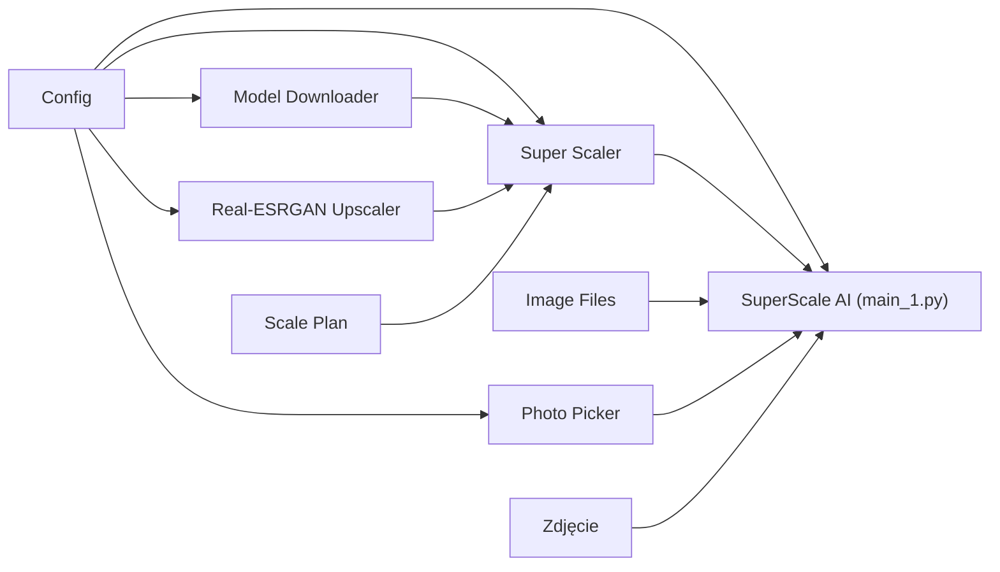

# SuperScale AI — powiększanie zdjęć modelem Real-ESRGAN, lokalnie

Powiększa zdjęcia **od 1× do 10×** i jednocześnie poprawia ich jakość — usuwa szum, rozmycie i artefakty
kompresji JPEG. Działa **na Twoim komputerze** (GPU albo CPU), bez wysyłania zdjęć do internetu.
Używa modeli **[Real-ESRGAN](https://github.com/xinntao/Real-ESRGAN)** (Tencent ARC) wczytywanych przez
bibliotekę [spandrel](https://github.com/chaiNNer-org/spandrel).

Nawet mnożnik **1** ma sens: sieć powiększa i czyści zdjęcie, a wynik jest zmniejszany z powrotem do
oryginalnego rozmiaru — detale dodane przez sieć zostają.

Projekt jest zbudowany w CatNip — wizualnym edytorze Pythona opartym na blokach. Każdy blok to jedna
klasa w osobnym pliku `.py` z własną stroną dokumentacji `.md`.

> [!WARNING]
> **To jest projekt poglądowy (edukacyjny).**
> Model AI **dorysowuje** szczegóły, których nie było w oryginale — powiększone zdjęcie wygląda ostrzej,
> ale te detale są przypuszczeniem sieci, a nie odzyskaną informacją. Wyniku nie należy traktować
> jako dowodu ani wiernego odtworzenia rzeczywistości (np. twarzy, tablic rejestracyjnych, napisów).
> Powiększając cudze zdjęcia, upewnij się, że masz do nich prawa. Modele pochodzą od autorów
> Real-ESRGAN i podlegają ich licencji. Autor projektu nie ponosi odpowiedzialności za sposób
> wykorzystania wyników.

## Jak działa

1. **Wybór zdjęć** — każdy blok *File content* w projekcie to jedno zdjęcie (dodaj kolejne bloki, żeby
   przetworzyć kilka naraz).
2. **Plan** — z mnożnika liczony jest docelowy rozmiar i dobierany model: **x2plus**, gdy wystarcza
   powiększenie boku ×2 (ok. 4× szybszy), **x4plus** powyżej; powyżej ×4 na bok — kilka przejść.
3. **Model** — przy pierwszym użyciu pobiera się sam (ok. 64 MB na model) do `models/`; suma SHA-256
   jest sprawdzana, a przerwane pobieranie wznawiane.
4. **Sieć** — zdjęcie przechodzi przez sieć **kafelkami** z zakładką, więc pamięć nie rośnie z jego
   rozmiarem i nie widać szwów.
5. **Dopasowanie** — wynik jest skalowany do dokładnego rozmiaru docelowego i zapisywany jako
   `Outputs/<nazwa>_x<mnożnik>.png`. W zakładce Output widać wynik i wycinek 1:1: zwykłe powiększenie
   obok AI.

## Wymagania

- **Python 3.10 lub nowszy**.
- Pakiety z [`requirements.txt`](requirements.txt): `torch`, `torchvision`, `spandrel`, `numpy`,
  `opencv-python-headless`.
- **Dostęp do internetu** przy pierwszym uruchomieniu (pobranie modelu z GitHuba autorów).
- Opcjonalnie karta NVIDIA z CUDA. Program sam sprawdza, czy zainstalowana wersja PyTorch obsługuje
  kartę; jeśli nie (np. starsze karty jak GTX 1050 Ti z nowymi wersjami PyTorch) albo gdy zabraknie
  pamięci GPU, liczy na CPU — wolniej, ale zawsze zadziała.
- **CatNip** — do wyboru zdjęć na kanwie i podglądu wyników w zakładce Output.

## Instalacja

```bash
git clone <adres-repozytorium>
cd SuperScaleAI

python -m venv .venv
# Windows:
.venv\Scripts\activate
# Linux / macOS:
source .venv/bin/activate

pip install -r requirements.txt
```

Na komputerze z kartą NVIDIA zainstaluj najpierw `torch` i `torchvision` w wersji z CUDA według
instrukcji na [pytorch.org](https://pytorch.org/get-started/locally/), a dopiero potem `requirements.txt`.

## Uruchomienie

### W CatNip

1. Otwórz `SuperScaleAI.catnip` w CatNip.
2. W bloku **Zdjęcie** wskaż plik obrazu (jpg, png, bmp, tif, webp). Kilka zdjęć — kilka bloków
   *File content*.
3. Ustawienia zmienisz w bloku **SuperScale AI (main)**: Inspector → sekcja **INITIALISER** → Refresh →
   zmień wartości → Apply.
4. Uruchom przepływ (Run). Wynik pojawi się w zakładce **Output** i w folderze `Outputs/`.

### Bez CatNip

```bash
python main_1.py
```

Zdjęcia są brane z bloków *File content* zapisanych w `SuperScaleAI.catnip`. Gdy wskazanego pliku nie ma
(np. na innym komputerze), program szuka go **po nazwie** obok projektu i w `Inputs/`. Najprościej więc
wrzucić zdjęcie do `Inputs/` pod nazwą wskazaną w bloku. Poza CatNip podgląd jest pomijany — wynik
znajdziesz w `Outputs/`.

## Ustawienia

Parametry bloku **SuperScale AI (main)** (sekcja INITIALISER):

| Parametr | Domyślnie | Zakres | Znaczenie |
|---|---|---|---|
| `scale_factor` | `10.0` | 1–10, ułamkowy | Mnożnik powiększenia. Poza zakresem uruchomienie kończy się komunikatem. |
| `factor_mode` | `pixels` | `pixels` / `side` | `pixels`: mnożnik liczby pikseli (2 → bok ×1,41; 10 → bok ×3,16). `side`: mnożnik boku (2 → bok ×2, 4× więcej pikseli; 10 → dwa przejścia x4, bardzo wolno). |
| `output_extension` | `.png` | `.png` / `.jpg` | Format wyniku (`.png` bezstratny). |
| `jpeg_quality` | `95` | 1–100 | Jakość JPEG, tylko dla `.jpg`. |
| `tile_size` | `256` | px | Bok kafelka; większy jest szybszy na GPU, ale zajmuje więcej pamięci. |
| `tile_overlap` | `16` | px | Zakładka kafelków, dzięki której nie widać szwów. |
| `outputs_folder` | `Outputs` | nazwa folderu | Folder wyników obok projektu. |

Listę modeli zmienia się w `SuperScaleConfig.py` (`REAL_ESRGAN_MODELS`) — można tam wpisać dowolny
model obsługiwany przez spandrel (ESRGAN, SwinIR, HAT, DAT…).

## Struktura projektu



| Blok | Plik | Do czego służy |
|---|---|---|
| Config | `SuperScaleConfig.py` | Ścieżki i ustawienia, lista modeli, sprawdzenie zakresów, dobór modelu do mnożnika. |
| Model Spec | `ModelSpec.py` | Rekord modelu: nazwa, skala, adres pobrania, suma SHA-256. |
| Scale Plan | `ScalePlan.py` | Rekord planu: rozmiar przed i po, model, liczba przejść. |
| Image Files | `ImageFiles.py` | Odczyt i zapis obrazów (OpenCV, także ścieżki z polskimi znakami), podgląd i porównanie detalu 1:1. |
| Model Downloader | `ModelDownloader.py` | Pobiera wagi z wznawianiem i sprawdza sumę SHA-256. |
| Real-ESRGAN Upscaler | `RealESRGANUpscaler.py` | Jedno przejście sieci kafelkami, na GPU albo CPU. |
| Super Scaler | `SuperScaler.py` | Doprowadza zdjęcie do docelowego rozmiaru: plan, przejścia sieci, dopasowanie. |
| Photo Picker | `PhotoPicker.py` | Zbiera zdjęcia ze wszystkich bloków File content; brakujące szuka po nazwie. |
| Zdjęcie | — | Blok File content: zdjęcie do powiększenia. |
| SuperScale AI (main) | `main_1.py` | Punkt wejścia i ustawienia uruchomienia. |

Każdy blok ma swoją szczegółową dokumentację w pliku `.md` o tej samej nazwie.

### Pliki i foldery

| Ścieżka | Opis | W repozytorium |
|---|---|---|
| `SuperScaleAI.catnip` | Projekt CatNip (graf bloków). | tak |
| `*.py`, `*.md` | Kod i dokumentacja bloków; `main_1.py` — punkt wejścia. | tak |
| `requirements.txt` | Zależności Pythona. | tak |
| `Inputs/jezioro_małe.jpg` | Małe zdjęcie przykładowe. | tak |
| `Inputs/` (pozostałe pliki), obrazy obok projektu | Twoje zdjęcia do powiększenia. | nie |
| `Outputs/` | Powiększone zdjęcia. | nie |
| `models/` | Pobrane wagi Real-ESRGAN (ok. 64 MB każdy). | nie |

## Podziękowania i licencje

- **Real-ESRGAN** — Xintao Wang i in., *Real-ESRGAN: Training Real-World Blind Super-Resolution with Pure
  Synthetic Data*, ICCVW 2021. Kod i wagi: [github.com/xinntao/Real-ESRGAN](https://github.com/xinntao/Real-ESRGAN)
  (licencja BSD-3-Clause). Wagi nie są częścią tego repozytorium — program pobiera je przy pierwszym użyciu.
- **spandrel** — [github.com/chaiNNer-org/spandrel](https://github.com/chaiNNer-org/spandrel).
- Licencja tego projektu nie została jeszcze wybrana — do czasu dodania pliku `LICENSE` wszystkie prawa
  zastrzeżone.

## Zastrzeżenie

Projekt ma charakter wyłącznie **poglądowy i edukacyjny**. Szczegóły dodane przez model są przybliżeniem,
a nie odzyskaną informacją. Korzystasz z niego na własną odpowiedzialność.
